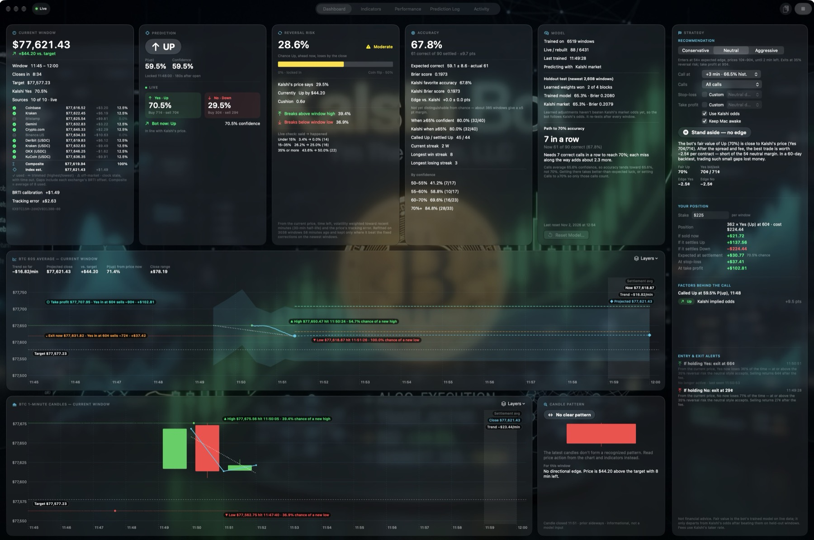
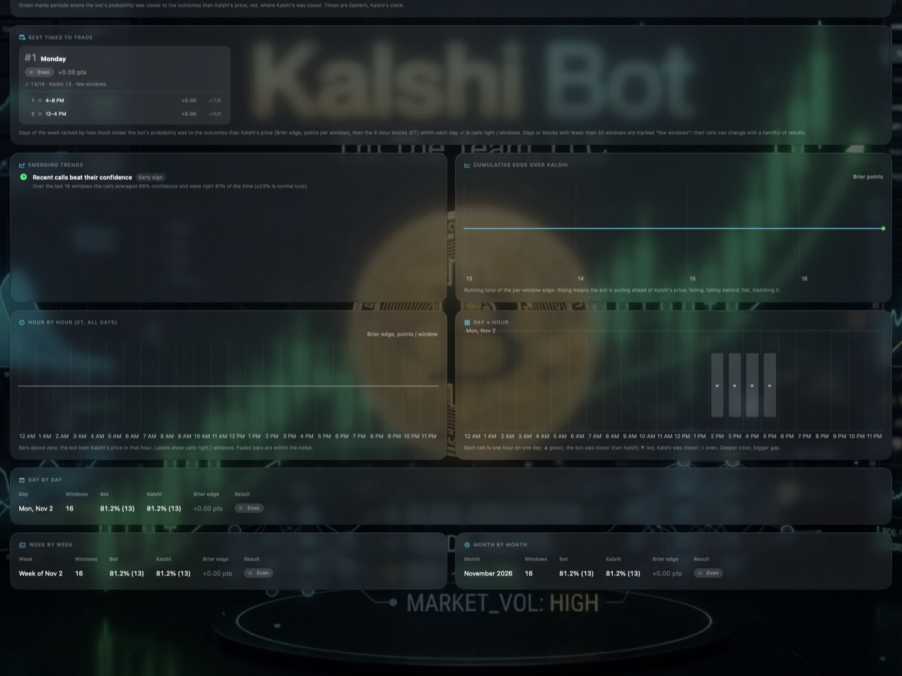
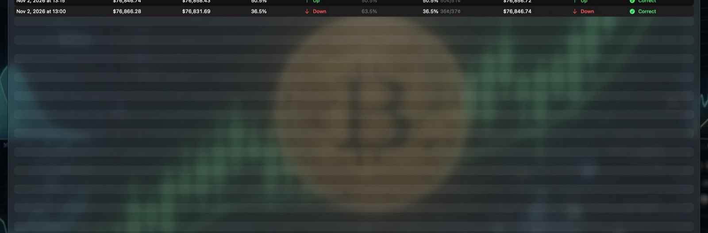
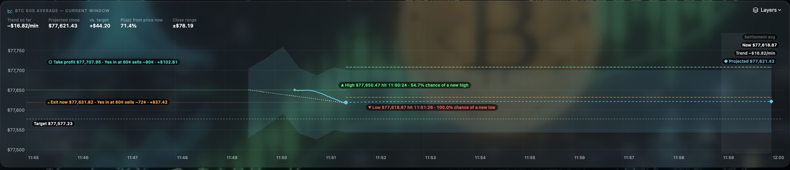

<h1 align="center">Kalshi Bot</h1>

A macOS app that calls every Kalshi 15-minute Bitcoin Up/Down window, shows the live odds and the evidence behind each call, and keeps an honest scorecard against Kalshi's own price.

<a href="docs/Kalshi-Bot-Brochure.pdf"><b>Brochure (PDF)</b></a> ·
<a href="docs/Kalshi-Bot-User-Manual.pdf"><b>User Manual (PDF)</b></a> ·
<a href="docs/USER_MANUAL.md">Manual (Markdown)</a> ·
<a href="CHANGELOG.md">Changelog</a> ·
<a href="docs/KNOWN_ISSUES.md">Known issues</a> ·
<a href="https://github.com/jaldrich2023/KalshiBot/releases">Releases</a>

<b>Current version: 2.17.1 (Build 33)</b> · macOS 27.2 or later

> **Not financial advice.** Kalshi Bot gives statistical estimates for information and education only. Its predictions are often wrong, past accuracy doesn't guarantee future results, and event contracts carry a real risk of loss. See [LICENSE](LICENSE), section 4.

## What it does

Kalshi's **KXBTC15M** markets ask one question every 15 minutes: will Bitcoin's settlement price, the CF Benchmarks BRTI 60-second average at the close, finish at or above the price at the open? Kalshi Bot follows every window:

- **Calls each window.** It makes a call (Up or Down, with a probability) at a minute you choose, from +3 to +12 minutes after the open. The call is locked and logged, then scored when Kalshi settles it.
- **Shows the live picture.** It builds its own BRTI estimate from ten exchange feeds, each corrected by its measured offset from the official index, and shows the typical tracking error. It also shows Kalshi's live Yes/No prices, and draws the 60-second average on a chart. The chart also marks the target, the window's actual high and low, a projected close, and your stop-loss and take-profit levels.
- **Estimates the risk of a reversal.** It gives the calibrated chance that the side now ahead loses (shown next to Kalshi's own figure), how strong the momentum is, and how likely the price is to break the window's high or low. The corrections refit from history, and a live check shows how often its figures came true.
- **Recommends trades for your style.** Conservative, Neutral and Aggressive set the required edge, the price range, the entry cutoff and the exits. It suggests entries only on the side it called. You can set your own stop-loss and take-profit percentages, and a stake for profit and loss estimates.
- **Keeps score honestly.** It reports accuracy with margins of error, Brier scores, and paired comparisons with Kalshi's favorite on the same windows. It shows how many correct calls it needs to reach 70%. Results are broken down by day, hour, week and month.
- **Trains itself and checks its work.** It learns from up to 180 days of public Kalshi and Coinbase history, saved on disk so later launches fetch only what's new, plus every live window. Learned weights are used only when they beat Kalshi's own odds in most of four walk-forward blocks of windows they weren't trained on. The other indicators are re-tested after every window and promoted only after significant wins on three separate sets of fresh windows, with the bar raised for testing several signals at once.
- **Runs unattended.** It keeps the Mac awake while it runs (optional), reconnects dropped or silent price streams on its own, and can reset just the model or clear everything after copying the log.

### What to expect

In testing on more than 6,000 past windows, Kalshi's price at the call was already well calibrated: calls priced at 55–60% won 58% of the time, and calls at 70–80% won 77%. Calling later in the window, or counting only confident calls, raises the hit rate (calls of 70% or more at +9 minutes were right 88% of the time), but those contracts cost correspondingly more. Fifteen technical indicators, order-book and trade-flow signals, and funding and volatility data added nothing beyond that price. Kalshi Bot is built to show you this clearly rather than hide it. When it can't beat the market, it says so and follows Kalshi's odds.

## Screenshots

| | |
| --- | --- |
|  |  |
| **Indicators.** Every signal, its value at the call and now, its weight, and why it is or isn't moving the call. | **Performance.** Day, hour, week and month, against Kalshi; hover any item for details. |
|  |  |
| **Prediction log.** Every call and result; hover a row for why it won or lost. | **60-second average chart.** Target, actual high and low, projection, stop-loss and take-profit. |

## Requirements

- macOS 27.2 or later
- Xcode 27.2 or later to build from source
- An internet connection. Kalshi Bot reads public market data and needs **no account and no API keys**. It never places orders.

## Building

1. Clone the repository and open `KalshiBot.xcodeproj` in Xcode.
2. Select the **KalshiBot** scheme and **My Mac**, then choose **Product › Run** (⌘R).
3. On first launch it downloads Kalshi's market history and rebuilds the past windows for training. This takes a few minutes the first time; progress shows in the Model card. The download is saved, so later launches take seconds.

Run the tests with **Product › Test** (⌘U). The suite uses Swift Testing. One long network research test (`KalshiFlowProbe`) is disabled by default; enable it to run it on demand.

## Project layout

| Path | Contents |
| --- | --- |
| `KalshiBot/Engine/` | `BotEngine` (the app's state and the window loop), `Predictor` (features and the market-anchored model), `ModelTrainer` (fitting, holdout tests, promotion trials), `ReversalRisk` (calibrated flip and breakout odds), `StrategyAdvisor` (styles, advice, exit plans), indicators, candle patterns and the close projection |
| `KalshiBot/Services/` | `LivePriceFeed` (WebSocket and REST exchange feeds, per-exchange offsets and the composite price), `MarketClients` (Kalshi, Coinbase history and the exchange clients) and `HistoryCache` (the saved market download) |
| `KalshiBot/Models/` | SwiftData records (`PredictionRecord`, `TrainingExample`), accuracy and performance statistics, call explanations and the app version |
| `KalshiBot/Views/` | The SwiftUI interface: dashboard cards, charts, the indicator guide, performance, the log and About |
| `KalshiBotTests/` | Unit tests (Swift Testing) |
| `docs/` | The user manual, brochure, known issues, screenshots and the scripts that build the PDFs |

## Documentation

- [User Manual](docs/USER_MANUAL.md) ([PDF](docs/Kalshi-Bot-User-Manual.pdf))
- [Brochure](docs/Kalshi-Bot-Brochure.pdf)
- [Known issues](docs/KNOWN_ISSUES.md)
- [Changelog](CHANGELOG.md)
- [Releases](https://github.com/jaldrich2023/KalshiBot/releases)
- [Third-party notices](THIRD_PARTY_NOTICES.md)

To rebuild the PDFs after editing the docs, run `docs/tools/make_pdfs.sh`. It regenerates the manual's HTML from `docs/USER_MANUAL.md` and prints both documents with WebKit, with no browser needed.

## Contributing and security

Kalshi Bot is proprietary software whose source is public to read. Bug reports and feature requests are welcome; see [CONTRIBUTING.md](CONTRIBUTING.md). Please report security problems privately, as described in [SECURITY.md](SECURITY.md). Everyone taking part follows the [code of conduct](CODE_OF_CONDUCT.md).

## License

Copyright © 2026 I'm The Team, LLC. All rights reserved. Kalshi Bot is licensed under the end user license agreement in [LICENSE](LICENSE). Being able to read the source doesn't give you any right to copy, modify or redistribute it.

Kalshi, CF Benchmarks, BRTI and the exchange names are trademarks of their respective owners. Kalshi Bot isn't affiliated with, endorsed by or sponsored by any of them.
