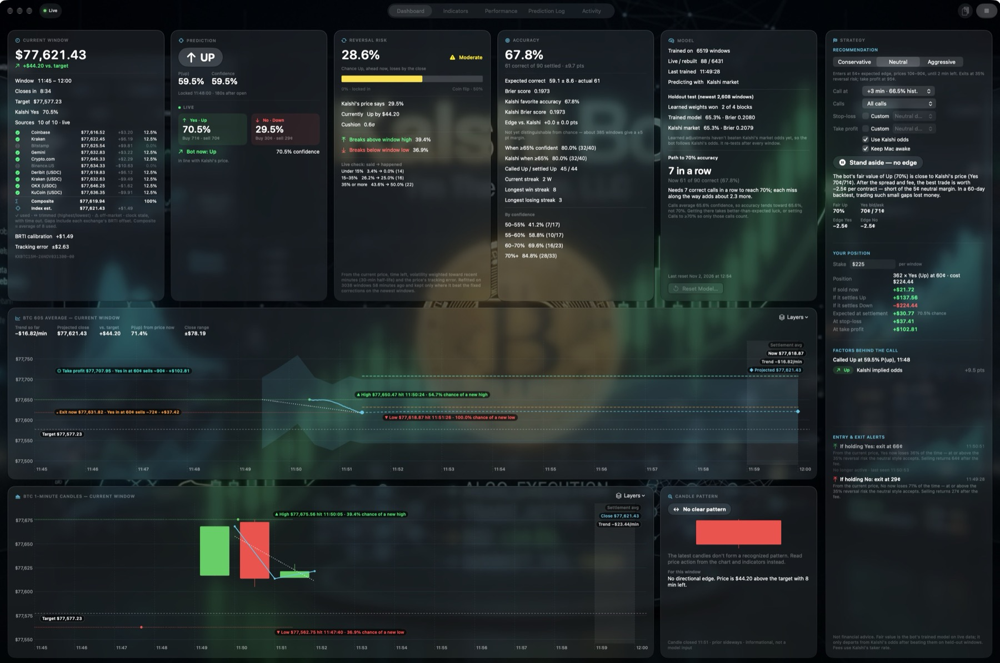
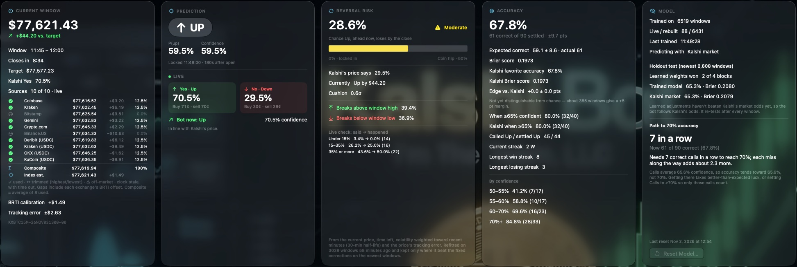
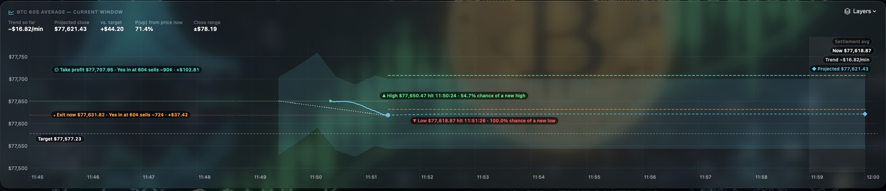
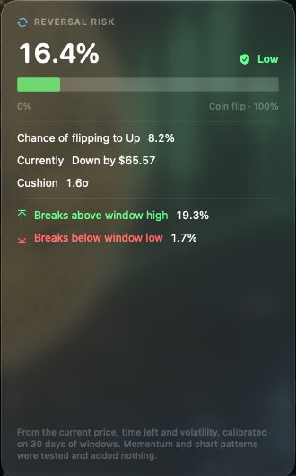
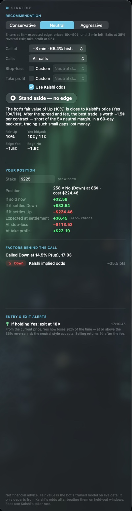
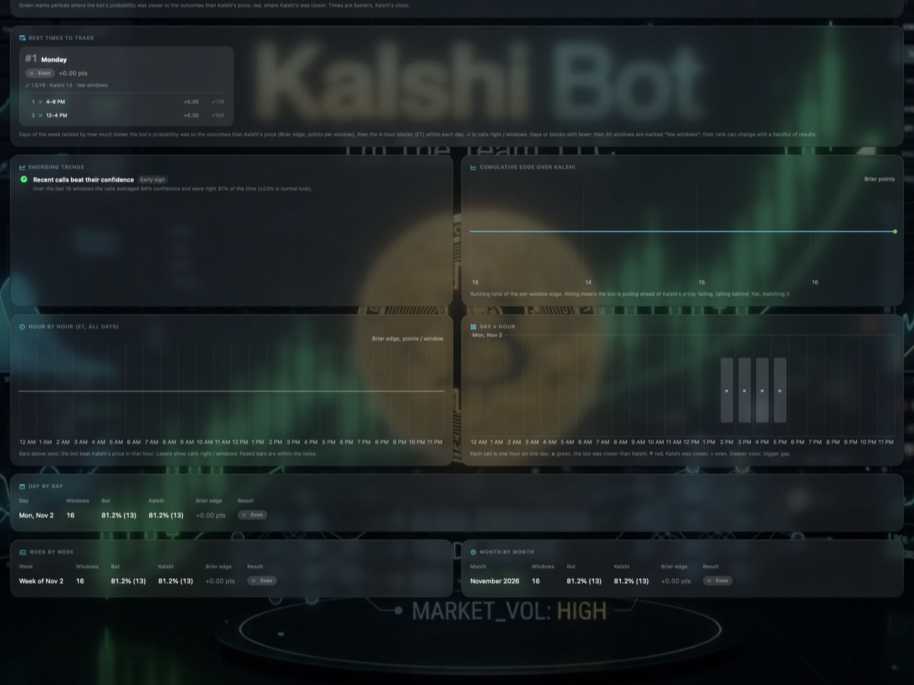
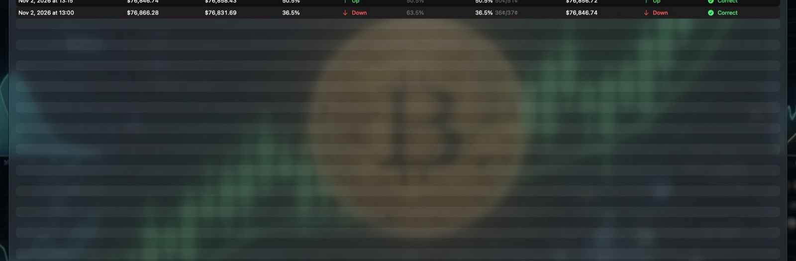
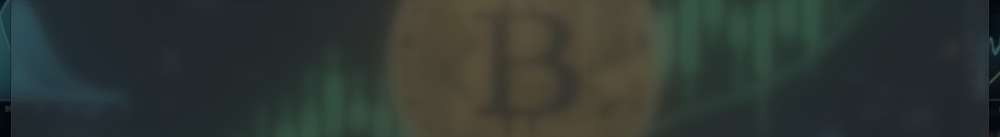

# Kalshi Bot — User Manual

Calls, live odds and an honest scorecard for Kalshi's 15-minute Bitcoin markets.

Version 2.28.0 · macOS 27.2 or later · © 2026 I'm The Team, LLC

Kalshi Bot follows every Kalshi KXBTC15M window. It makes a call at the minute you choose, shows you the live market and the evidence behind the call, suggests entries and exits for your trading style, and scores every result against Kalshi's own price. This manual explains every card, chart and setting.

---

## Contents

## 1. Getting started

### Before you begin

> **Kalshi Bot isn't financial advice.** It gives statistical estimates for information and education only. Every call is a probability, not a certainty: a 70% call is expected to miss about 3 times in 10, and past accuracy doesn't guarantee future results, and event contracts carry a real risk of loss. You're responsible for your own trading decisions.

You need:

- a Mac running macOS 27.2 or later,
- an internet connection.

You don't need a Kalshi account or any API keys. Kalshi Bot reads only public market data, and it **never places orders**. Any trade you make, you make yourself on Kalshi.

### First launch

1. Open Kalshi Bot. It starts automatically, and the status pill at the top left of the toolbar turns to **Live**. The window has a fixed size of 2,400 × 1,600 points; on a smaller screen it shrinks to fit and the dashboard scrolls inside it.
2. The **Model** card shows "Rebuilding past windows…". Kalshi Bot downloads up to 180 days of Kalshi market history and Coinbase 1-minute candles, then rebuilds each past window as it looked at the call. This takes a few minutes the first time. The download is saved, so later launches fetch only what's new.
3. When the current window reaches the call time (+3 minutes by default), the **Prediction** card locks a call: Up or Down, with a probability.
4. When the window closes and Kalshi settles it, the call is scored, the **Accuracy** card updates, and the model retrains.

While it's running, Kalshi Bot keeps your Mac from sleeping, so it doesn't miss a window (turn off **Keep Mac awake** in the Strategy card to allow sleep). Click **Stop** in the toolbar to pause it; click **Start** to resume.

### The toolbar

| Item | What it does |
| --- | --- |
| Status pill | **Live** while the bot is running. |
| Tabs | Dashboard, Indicators, Performance, Prediction Log and Activity. |
| Copy CSV | Copies the whole prediction log to the clipboard as CSV, for a spreadsheet. |
| Start / Stop | Starts or pauses the bot. |

### Menus

| Item | What it does |
| --- | --- |
| Kalshi Bot › Check for Updates… | Asks for the newest release and, if it's newer, shows a notice with a download button. It never downloads or installs by itself. The app also checks at launch, at most every 6 hours. |
| Kalshi Bot › Settings… (⌘,) | Privacy: **Send crash and bug reports** (off by default) and **Send anonymous install notice**. |
| Help › Report a Problem… | Sends a bug report or feedback you write, with an optional contact e-mail and recent logs. **Preview…** shows exactly what will be sent. |

### Popover tips

Every field explains itself. Rest the pointer on any figure, label, setting or button for a moment and a popover opens with its name and a fuller explanation: what it measures, how it's calculated and how to read it. Moving away, clicking, typing or scrolling closes it. In the Prediction Log and the Performance tab's charts and tables, hovering opens the detailed breakdown for that window or period instead.

## 2. How the markets work

Each KXBTC15M market covers one 15-minute window, for example 5:00–5:15 PM Eastern. It asks a single question: **will Bitcoin settle at or above the target?**

- **The target** is the CF Benchmarks Bitcoin Real Time Index (BRTI), averaged over the 60 seconds before the window opens.
- **The settlement** is the same 60-second average over the last minute of the window.
- **Yes** pays $1 if it settles at or above the target ("Up"). **No** pays $1 if it settles below ("Down").
- A contract's price, between 1¢ and 99¢, is the market's probability. Yes at 62¢ means the market gives Up about a 62% chance.

Kalshi charges a taker fee on each order, rounded up to the next cent: 7% × contracts × price × (1 − price). Kalshi Bot includes this fee, and half the bid/ask spread, in every edge and profit figure it shows: per contract for the edges, and once per order for your position's cost and profit.

Because both the target and the settlement are 60-second averages, the last minute matters a lot. Once the settlement minute starts, every second that passes locks in part of the answer. Kalshi Bot's odds take that into account.

## 3. The Dashboard

### Current Window

- **The price** is Kalshi Bot's estimate of the BRTI right now, with how far it is above or below the target.
- **Window, Closes in, Target, Kalshi Yes** show the window's times, the time left, the target price, and Kalshi's live Yes price.
- **Sources** lists the ten exchange feeds: Coinbase, Kraken, Bitstamp, Gemini, Crypto.com, Binance.US, Deribit (USDC), Kraken (USDC), OKX (USDC) and KuCoin (USDC). Each row shows the latest price, the gap to the composite (after that exchange's offset), and its weight. A ✓ means the source is in use. A source is dropped when its price is off-market (more than 0.05% from the median) or its feed has gone stale; instead of a weight, it then shows how long it's been out. With five or more sources, the highest and lowest are trimmed. Hover a row for its offset and how often its stream has reconnected.
- **Per-exchange offsets.** At every window open, each exchange's 60-second average is compared with Kalshi's official target. Once three exchanges have been measured at six opens, each one's typical gap (its median offset) is added to its price before averaging. Exchanges that haven't been measured yet use the typical offset of the others. This keeps the composite steady when a source drops out or comes back.
- **Composite** is the weighted average of the sources in use. Once the offsets are measured, an exchange whose gap to the official index is steady counts more than one whose gap wanders, up to 25% each; until then all count equally. The weight column shows each exchange's share. **Index est.** adds the **BRTI calibration**, a running correction for whatever gap remains.
- **Tracking error** is how far the index estimate typically was (the median) from Kalshi's official target at recent opens. Only windows that finish within about that much of their target are at risk of being misjudged.
- The window's ticker is shown at the bottom, for example `KXBTC15M-26NOV021815-15`.

### Prediction

Before the call time, the card says "No prediction locked for this window" and shows the live view only. At the call time it locks:

- **The call:** a large **UP** or **DOWN**, with P(up) and the confidence (the probability of the side called).
- **Calls like this:** how often past calls in the same 5-point confidence band, at the same call minute, were right. For example: "Calls like this (70–75% at +3 min) won 77% of 1,448 past windows."
- **WAITING** (with **Wait** on): the call hasn't locked yet. It locks the first moment, up to +12, that the bot reaches the confidence set under **Wait**, and the card then shows when it locked. If it never does, the card says **NO CALL**.
- **Close call** (orange, only when it applies): the price was within 0.5σ of the target when the call locked (σ is the price movement still expected before the close), or already on the other side. In 6,467 past windows, calls that close lost 40% of the time (48% when already on the other side), against about 20% for the rest. Raising **Calls** to 60–70% skips most of them.
- **Live:** Kalshi's Yes and No prices right now, as percentages, with the buy and sell prices in cents.
- **Bot now:** what the model would say from the current price. This is for information only; the locked call doesn't change.

### Accuracy

The scorecard for every settled call:

- **Accuracy**, with how many were correct and its 95% range (a Wilson interval, which stays between 0% and 100% and is never ±0).
- **Expected correct:** how many the bot's own probabilities said should be right, with a 95% range. If the actual number is inside the range, the difference is ordinary luck.
- **Brier score:** the average squared error of the probabilities. Lower is better; 0.25 is a coin flip.
- **Kalshi favorite accuracy, Kalshi Brier score:** the same measures for Kalshi's own price, on the windows that had a Kalshi price at the call.
- **Edge vs. Kalshi:** the bot's accuracy minus Kalshi's on the same windows. Only windows where the two called different sides can differ, so it's judged with an exact test on those: "more than chance" needs at least 6 such windows all won by the same side, or more when they're split.
- **When ≥65% confident:** accuracy on the more confident calls, for the bot and for Kalshi.
- **Streaks:** the current streak, the longest win streak and the longest losing streak.
- **By confidence:** accuracy in each confidence band. Well-calibrated calls are right about as often as their confidence says. For example, 55–60% calls should lose about 4 times in 10.

If **Calls** is set to confident calls only (see chapter 4), the card says how many low-confidence windows were skipped.

### Model

- **Trained on:** the windows the model learned from. **Live / rebuilt** splits them into windows the bot watched live and windows rebuilt from history.
- **Predicting with:** **Kalshi market** while learned adjustments haven't beaten Kalshi's own odds, or **Learned weights** once they have.
- **Holdout test:** the trained model and Kalshi's price, scored walk-forward on the newest 40% of windows. That stretch is split into four blocks in time order, and each block is scored by a model fitted only on the windows before it. **Learned weights won** shows how many blocks the learned weights beat Kalshi in.
- **Path to 70% accuracy:** the number of correct calls in a row needed to bring overall accuracy to 70%, or, once it's there, how many misses in a row it can absorb. Each miss on the way adds about 2.3 more needed. The note underneath compares the goal with the calls' average confidence, which is where accuracy tends over time.
- **Reset Model…** offers two choices: reset only the model, or clear all data. See chapter 10.

### The 60-second average chart

This chart follows the same 60-second average that Kalshi settles on, across the whole window.

- **Target:** the dashed line the window must finish at or above for Up.
- **High and Low:** the highest and lowest values the 60-second average has actually reached in this window, with the time and the chance of a new high or low before the close.
- **Now, Trend and Projected:** the current value, the trend over the last few minutes, and the projected close, with the likely close range shaded.
- **Settlement minute:** the shaded final minute.
- **Stop-loss and Take profit:** once a call is locked, these show where to exit the side that was called. Each label says what the contract would sell for at that price and your profit or loss at your stake. See chapter 4.

Use **Layers** at the top right to show or hide each element: the 60s average, Now, Target, Settlement minute, High/Low, Close range, Trend, Projection, and Stop & take profit. Labels are arranged so they don't overlap one another, the lines, or the Now dot.

### The 1-minute candles chart

The same window as 1-minute candles, with its own **Layers** menu. The **Candle pattern** card beside it names any recognized pattern in the latest candles, such as a hammer, an engulfing pattern, a doji or three white soldiers, and says whether it gives this window an edge. Patterns are informational only; they aren't model inputs.

### Reversal Risk

- **The headline percentage** is the chance that the side ahead now loses by the close. It's labeled **Low** (under 15%), **Moderate** (15–35%) or **High** (35% or more). The bar runs from 0% (locked in) to 50% (a coin flip: the price sitting on the target, the most a reversal can be).
- **Kalshi's price says:** the same outcome priced by Kalshi (1 − the leading side's price), for comparison.
- **Currently, Cushion:** how far the price is from the target, and that distance in units of expected movement (σ).
- **Momentum strength:** how strongly the price has moved over the last 3 minutes compared with normal, and whether it's moving with or against the side that's winning.
- **Breaks above window high, Breaks below window low:** the chance of a new high or low before the close.
- **Final minutes, close to the target:** in the last three minutes, while the cushion is under 0.5σ, this replaces the ordinary close-to-target note. 21% of past losing calls turned in the last two minutes, and calls this close at +12 lost 42%.

- **Live check:** every minute the card's figure is logged, and scored once the window settles. For each band (under 15%, 15–35%, 35% or more) the card shows what it said on average and how often the leading side actually lost. Close agreement means the card is well calibrated; small counts are noisy.

These odds come from a random-walk model of the 60-second average. The uncertainty includes the price's **tracking error**, so a few-dollar cushion isn't treated as certain. After each history rebuild (at most hourly), the bot refits the corrections from the saved history. It fits on the older 80% of windows, scores on the newest 20%, and keeps a refit only where it does better. It tries three volatility weightings (the last hour equally, or a 30- or 15-minute half-life) and a blend with Kalshi's price.

In the Nov 3 backtest of 3,038 windows, the card was well calibrated: when it said about 10%, 20%, 30% and 43%, the leading side lost 8%, 22%, 32% and 44% of the time. That matched Kalshi's price (Brier 0.1611 vs. 0.1615), and blending the two didn't help, so the card shows Kalshi's figure alongside rather than mixed in. The refit improved the breakout odds, and volatility weighted toward the last 30 minutes scored best. Momentum, pullbacks, wicks, RSI and target crossings were all tested as early warnings; none added anything.

## 4. Trade recommendations

The **Strategy** card on the right of the dashboard turns the call and Kalshi's prices into a suggestion. It never trades for you.

### Trading styles

Choose **Conservative**, **Neutral** or **Aggressive** at the top of the card:

| Setting | Conservative | Neutral | Aggressive |
| --- | --- | --- | --- |
| Minimum edge to enter (per contract, after fees) | 8¢ | 5¢ | 3¢ |
| Contract prices it will suggest | 25¢–75¢ | 10¢–90¢ | 1¢–99¢ |
| No new entries with less than | 5 min left | 2 min left | 1 min left |
| Exit when the side's chance of losing reaches | 25% | 35% | 50% |
| Default stop-loss (share of the price paid) | 30% | 50% | 70% |
| Take-profit (share of the most it could sell for) | 60% | 80% | 95% |
| Trailing stop keeps at least this share of the best gain | 60% | 50% | 30% |

### The recommendation

The headline is one of:

- **Buy Yes** or **Buy No**, when the side called is cheap enough compared with the bot's fair value to clear the style's edge, after the fee and half the spread. Entries are suggested only on the side the bot called.
- **Stand aside — no edge**, when the price is close to fair value. This is the usual case when the bot follows Kalshi's odds.
- **Stand aside — against the call**, when the only edge would be on the side the bot didn't call.

Underneath, the card shows the bot's fair value, Kalshi's Yes bid and ask, and the edge on each side.

### Call settings

| Setting | Choices | What it does |
| --- | --- | --- |
| Preset | Standard (+3 min, ≥60%) or High hit rate (wait for 80%) | Sets **Call at**, **Calls** and **Wait** together. High hit rate waits from +3 until a call is 80% confident: in a backtest on 1,941 recent windows it was right 84% of the time and called 87% of windows (Standard's calls: 73%). It raises accuracy, not profit: those contracts cost correspondingly more. |
| Call at | +3 to +12 min | When each window's call locks. The menu shows how often calls at that minute were right in history. Later calls are right more often, but Kalshi's price has moved too. Changing it rebuilds the model's history at the new time. |
| Calls | All calls, or only ≥60% (the default), 65%, 70%, 75% or 80% confident | Calls below the threshold are marked **No call** and left out of accuracy and performance. Every window is still logged and trained on. |
| Wait | Off (the default), or until 75%, 80%, 85% or 90% confident | With Wait on, the call doesn't lock at **Call at**: it waits, up to +12, until the bot is at least that confident — once the reversal risk of the side ahead is at most 100% minus that — and locks then. If it never gets there, the window is a **No call**. While it waits, the Prediction card says **WAITING** with the confidence now. In a backtest on 1,941 recent windows: 75% → right 80.5% on 93% of windows (average call at +6); 80% → 84.3% on 87% (+7); 85% → 89.0% on 77% (+8); 90% → 93.6% on 65% (+9). Calling every window at +3 was right 65.6%. The model still learns from every window at **Call at**, so changing Wait rebuilds nothing. |
| Stop-loss | Style default, or Custom: 5%–70% | The share of the price paid that you're willing to lose before exiting. |
| Take profit | Style default, or Custom: 5%–100% | The gain on the price paid at which to sell. If the gain isn't possible at the current price, the card says it's unreachable and no line is drawn. |
| Use Kalshi odds | On or off | When on, the model starts from Kalshi's price and adjusts it only with signals that have proven themselves. **Leave this on.** With it off, the model uses price signals alone, which is much less accurate and can disagree with the market for no good reason; the card shows a warning while it's off. |
| Keep Mac awake | On (default) or off | Stops the Mac from idle-sleeping while the bot runs. With it off, the Mac can sleep and the windows during sleep are missed. |

### Your position

Enter your **Stake** per window. Once a call is locked, the card shows:

- how many whole contracts the stake buys on the called side, at the ask, and what they cost,
- **If sold now:** the result of selling at the bid, after the fee,
- **If it settles Up / Down:** the result at settlement either way,
- **Expected at settlement:** the average of the two, weighted by the bot's probability,
- **At stop-loss** and **At take profit:** the result if you exit at those lines.

### Stop-loss and take-profit lines

Both lines are drawn on the 60-second average chart, in Bitcoin prices, so you can see how far the price has to move to reach them. They're based on the current market: the time left, volatility, and how far Kalshi's price has strayed from the bot's odds.

- **Stop-loss** limits your loss if the call is going wrong. After you've been in profit by at least 10¢ (or a quarter of the best gain), it becomes a **trailing stop**, which keeps at least the style's share of the best gain so far.
- **Take profit** locks in a gain when the call is going right.

### Entry and exit alerts

The **Entry & exit alerts** list shows each suggestion as it happens, with the time and the reason. For example: "If holding Yes: exit at 14¢. From the current price, Yes now loses 86% of the time…". Alerts that no longer apply are marked **No longer active**.

**What exits are for.** Exits limit how much a window can lose; they don't improve the expected result. In a backtest on the newest 1,941 windows, selling the called side whenever its price fell below any level from 45¢ to 10¢ did no better than holding to settlement (−0.17¢ ± 0.56¢ a contract), because Kalshi's price already reflects the risk and selling pays a second fee. The card says so above the alerts.

## 5. Indicators

The **Indicators** tab shows every signal the bot computes, each on its own card:

- **At call / Now:** the value when the call locked, and the value now.
- **Weight:** the signal's weight in the model. **Not used** means it isn't a model input.
- **Favors Up / Favors Down:** the direction the signal points.
- **Reading now:** what the value means in plain language.
- **Effect on prediction:** whether it's moving the call and why.
- **Windows:** how many settled windows have this signal (live windows, for live-only signals).
- **Promotion** (context signals only): its streak of counted results, how many windows until its next result can count, and the fewest windows before it could be promoted.

The **Switching to learned weights** panel at the top lists the three conditions for predicting with learned weights instead of Kalshi's odds, with the current numbers for each. There's no fixed window count; the conditions are re-checked after every settled window.

### Model inputs

**Spot vs. target**, **5m momentum**, **RSI(14)** and **Kalshi implied odds** are the only signals that can move the call. Each starts at zero weight and earns weight only by improving predictions on held-out windows. Kalshi's implied odds are the anchor: the call starts from Kalshi's price, and the others can shift it only once they've proven themselves.

### Context only

**Last-60s tick momentum**, **15m momentum**, **EMA 9/21 trend**, **Bollinger %B**, **Stochastic %K** and **VWAP(60) deviation** move closely with a model input, so counting them too would count the same information twice. After every retrain, each is re-tested on held-out windows; three significant wins in a row would promote it into the model. Tick momentum exists only in live windows, so it's tested on those alone, once 500 are available.

Three **combination signals** are trialled the same way. Each counts a signal only where it plausibly matters: **Momentum near the target** and **RSI near the target** fade to zero as the cushion grows, and **Momentum when Kalshi is unsure** fades as Kalshi's price moves away from 50/50. They're computed from the stored signals, so they're tested on the full history.

### What has been tested

Held-out tests (fit on older windows, scored on newer ones) found **no signal that predicts these windows beyond Kalshi's own price at the call**. This includes the 15 technical indicators; ADX and ±DI; order-book imbalance; Coinbase taker trade flow; the Deribit perpetual premium and funding rate; and DVOL. Kalshi's price was well calibrated across more than 6,000 windows. Calls at 55–60% won 58% of the time, at 60–65% they won 63%, and at 70–80% they won 77%.

Kalshi's bid–ask spread (1¢ in 99.8% of windows at the call), its volume, the last trade versus the mid, and the previous window's result were also tested on Nov 3; none helped. That's why the bot usually follows Kalshi's odds. If you want a higher hit rate, take only the confident calls, with **Calls** set to ≥60% or higher. Low-confidence calls are close to coin flips, and they're priced that way.

## 6. Performance

The **Performance** tab compares the bot with Kalshi's price over time. All times are Eastern, Kalshi's clock. Green marks periods where the bot's probabilities were closer to the outcomes than Kalshi's; red marks periods where Kalshi's were closer.

- **Against Kalshi:** windows, bot accuracy, Kalshi favorite accuracy, and the **Brier edge** per window. That's Kalshi's squared error minus the bot's, in points. Positive means the bot was closer.
- **Best times to trade:** days of the week ranked by Brier edge, each with its 4-hour blocks ranked. Days or blocks with fewer than 30 windows are marked "few windows", because a handful of results can change their rank.
- **Emerging trends:** patterns forming in recent results, such as calls beating their confidence. Each is marked as an early sign or as confirmed.
- **Cumulative edge over Kalshi:** the running total of the per-window edge. Rising means the bot is pulling ahead, falling means it's falling behind, and flat means it's matching Kalshi.
- **Hour by hour and Day × hour:** the edge for each hour of the day, and for each hour on each day.
- **Day by day, Week by week, Month by month:** tables of every period, with **beyond noise** shown when the Brier difference is bigger than its margin of error and at least 10 windows in the period differ. Each period's verdict (beat, trailed or even with Kalshi) follows the same Brier edge.

### Hover for details

Rest the pointer on any bar, heatmap cell, day card, time block or table row. After a moment, a popover opens at the pointer with that period's details: windows, accuracy for the bot and Kalshi, Brier edge with its margin, whether it's beyond the noise, how many windows settled Up, the bot's average confidence, and how often the bot and Kalshi disagreed. On the cumulative edge chart, the popover shows the nearest window's full call breakdown and what that window added to the running edge. Popovers open away from the nearer edge of the screen.

## 7. Prediction Log

Every window the bot has followed, newest first:

| Column | Meaning |
| --- | --- |
| Window | The window's start time. |
| Target | The window's target price. |
| Spot at call | The bot's BRTI estimate when the call locked. |
| P(up) | The bot's probability of Up. |
| Call | ↑ Up or ↓ Down. |
| Confidence | The probability of the side called. Faded when the call is below your Calls threshold. |
| Kalshi Yes | Kalshi's Yes price at the call, with the bid and ask. |
| Settled at | The settlement value. |
| Outcome | ↑ Up in green or ↓ Down in red. |
| Result | Correct, Wrong, Live (not settled yet), or No call. |

Rest the pointer on a row to highlight it. After a moment, a popover explains **why the call succeeded or failed**: where the price stood at the call, whether the lead held or reversed, how close the finish was, and which signals moved the call.

**Copy CSV** in the toolbar copies the whole log, including bid and ask, for a spreadsheet.

## 8. Activity

A timestamped list of what the bot is doing: windows opening, calls locking, settlements, retraining results, history rebuilds and alerts. If something looks wrong, this is the first place to check, and the lines to include in a bug report.

## 9. How the model learns

- **Training data.** Every settled window is a training example: the live windows the bot watched, plus past windows rebuilt from Kalshi's history and Coinbase's 1-minute candles (up to 180 days). Recent windows count more than old ones.
- **Market-anchored.** The model starts from Kalshi's own odds. Learned weights adjust those odds only when the inputs carry information the price doesn't.
- **Held-out check.** After every settlement the model is scored walk-forward: the newest 40% of windows is split into four blocks, and each is predicted by a model fitted only on the windows before it. Learned weights are used only if they beat Kalshi's odds in at least three of the four blocks *and* their overall gain is bigger than its margin of error, so chance can't switch the bot over; otherwise it follows Kalshi. Once on, they stay on unless they fall clearly behind (fewer than half the blocks won, or significantly worse overall), so a small dip doesn't flip the bot back and forth.
- **Promotion trials.** Context-only signals are re-tested after each retrain. A result counts toward promotion only when it's judged on at least 200 windows that settled since that signal's last counted result, so three wins in a row are three separate pieces of evidence (about six days apart at minimum). The significance bar is also raised for testing nine signals at once (a z of about 2.77 instead of 1.96), so one signal doesn't look significant by chance.
- **Updates right after the close.** Accuracy updates and the model retrains as soon as Kalshi settles a window, without waiting for the next call.

## 10. Your data

Your prediction log, history, model and settings stay on your Mac, in Kalshi Bot's sandboxed container. Apart from the public market-data requests described in [THIRD_PARTY_NOTICES](../THIRD_PARTY_NOTICES.md), the only things sent anywhere are the install notice and crash reports below.

**Install notice.** Kalshi Bot sends an anonymous install notice to I'm The Team, LLC (`www.imtheteam.com`) once per installation, and again after each update and about once a month: a random install id generated on your Mac, the app version and build, the macOS version, the Mac model (for example `Mac16,10`), the locale and the time zone (for example `America/Chicago`). The app never looks up its own location; the server derives an approximate one (country, region, city) from the IP address of the connection that delivers the notice. It contains no personal data — no name, account, serial number, prediction log or trading data, and the app doesn't send its IP address itself. The reply may name a newer release, which the app offers as a dismissible notice; it never downloads or installs anything by itself. To turn it off, uncheck **Send anonymous install notice** in **Kalshi Bot › Settings…** (⌘,).

**Crash and bug reports.** Reporting is **off by default**. Turn it on in **Kalshi Bot › Settings…** (⌘,) with **Send crash and bug reports**, and off the same way. When it's on and Kalshi Bot crashes, the next launch sends an anonymous report to I'm The Team, LLC: the crash type and message, the stack trace, a fingerprint that groups repeats, the last 300 lines of the app's own log with API keys, tokens, passwords and e-mail addresses masked, the app and macOS versions, the Mac model, the locale, the random install id and the bot's non-personal settings (call time, threshold, trading style and similar — not your stake). While it's off, a crash leaves only a local file, and the next launch asks once — **Send**, **Don't Send** or **Always Send**. **Help › Report a Problem…** sends a bug report or feedback you write yourself (with an optional contact e-mail and, if you leave it checked, recent logs; **Preview…** shows exactly what will be sent); it works whether or not automatic reports are on. Paths under your home folder are shortened to `~` and your user name is removed; no documents, window titles or clipboard contents are included. Crash files wait in `~/Library/Containers/I-m-The-Team.KalshiBot/Data/Library/Application Support/crashes/` (at most 20). A report that can't be sent yet waits in the `outbox` folder beside it (at most 50) and is retried at the next launch and every 10 minutes, backing off up to 12 hours; the app's logs are in the `Logs` folder there too.

**Reset Model…** in the Model card offers three choices:

- **Reset Model, Keep Data** returns the weights, promotions and trials to their starting point and retrains on the data already collected. The prediction log, accuracy, training history and calibration are kept.
- **Copy Log, Then Clear All Data** copies the prediction log to the clipboard as CSV, then permanently deletes:
  - the prediction log and accuracy history,
  - the training history,
  - the price calibration, exchange offsets and tracking error,
  - the call-time statistics,
  - the alerts and the activity log.

Your settings and the saved market download are kept, so the model retrains from Kalshi's full market history in seconds. Paste the CSV into a spreadsheet or text file if you want to keep the old log.

- **Erase Everything, Including Settings…** asks a second time, then deletes everything Kalshi Bot has stored: everything above, plus every setting (trading style, call time, stake, stop-loss and take-profit, and the rest), the Reversal Risk calibration and live check, and the saved market download. The app then relaunches as if newly installed, with default settings, and downloads Kalshi's full market history again (a few minutes). Choose **Copy Log, Erase and Relaunch** to keep a CSV of the prediction log on the clipboard.

The saved market download (`MarketHistory.v1.json`) lives in the app's Caches folder. It holds only public market data, and macOS may clear it to free space; the next rebuild then downloads it again.

## 11. Troubleshooting

**The Prediction card says "No prediction locked for this window".** The call locks at the minute set in **Call at** (+3 by default). If the bot was started after that minute, it waits for the next window.

**The bot recommends a side that the market clearly disagrees with.** Check that **Use Kalshi odds** is on. With it off, the model uses price signals alone and can disagree with the market for no good reason.

**My 55–60% calls keep losing.** That's expected: a 57% call loses about 43% of the time. **Calls** skips calls under 60% by default; raise it to skip more.

**Fewer than 10 sources are live.** A source is dropped when its feed goes stale or its price is more than 0.05% away from the others; the list shows how long it's been out. The composite needs only a few sources. Dropped streams reconnect on their own, and a stream that goes silent for 30 seconds is replaced automatically.

**The Model card says learned adjustments haven't beaten Kalshi's odds.** That's the normal state. The bot anchors on Kalshi's well-calibrated price and adds a signal only once it proves itself on windows it wasn't trained on.

**A window shows no call although the bot was running.** If fetching fresh data delayed the call past the allowed time, the window is skipped rather than called late; the Activity tab says so. Windows Kalshi never settles are marked void, and in the repeated hour when clocks fall back a window with no matching Kalshi market is skipped. See [Known issues](KNOWN_ISSUES.md).

**Edge vs. Kalshi says "not yet distinguishable from chance".** That's normal: the bot follows Kalshi's odds, so they rarely disagree, and only disagreements can show an edge.

**The charts say "Collecting 60s of prices…".** The 60-second average needs a minute of prices after launch or after a gap in the feeds.

**The Model card has said "Rebuilding past windows…" for a long time.** The first download depends on Kalshi's and Coinbase's public APIs, which can be slow or limit requests. Leave the app running; failed requests are retried, and anything still missing is fetched at the next catch-up (every 15 minutes).

## 12. Legal

Kalshi Bot is free and open-source software under the [MIT License](../LICENSE): you may use, copy, modify and distribute it, provided the copyright notice and license are included. It comes with no warranty. The full terms on financial risk, third-party data and trademarks are in the [disclaimer](../DISCLAIMER.md).

Kalshi Bot isn't financial advice. Its calls are probabilities, not certainties, and event contracts and digital assets involve a substantial risk of loss.

Kalshi, CF Benchmarks, BRTI and the exchange names are trademarks of their respective owners. Kalshi Bot's BRTI estimate is an independent approximation, not the official index. Kalshi Bot and I'm The Team, LLC aren't affiliated with, endorsed by or sponsored by any of them.
